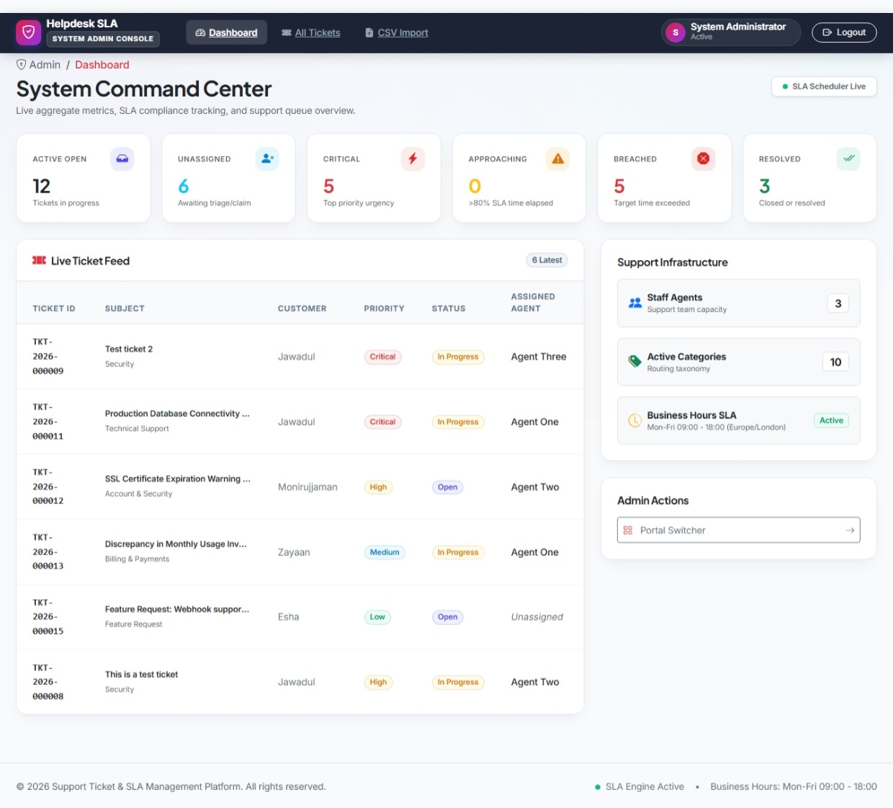
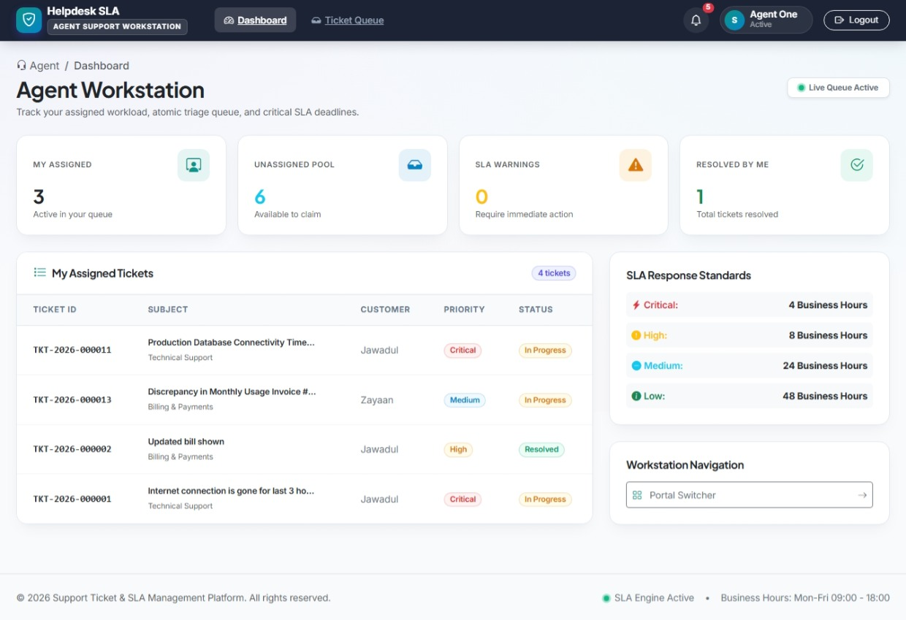
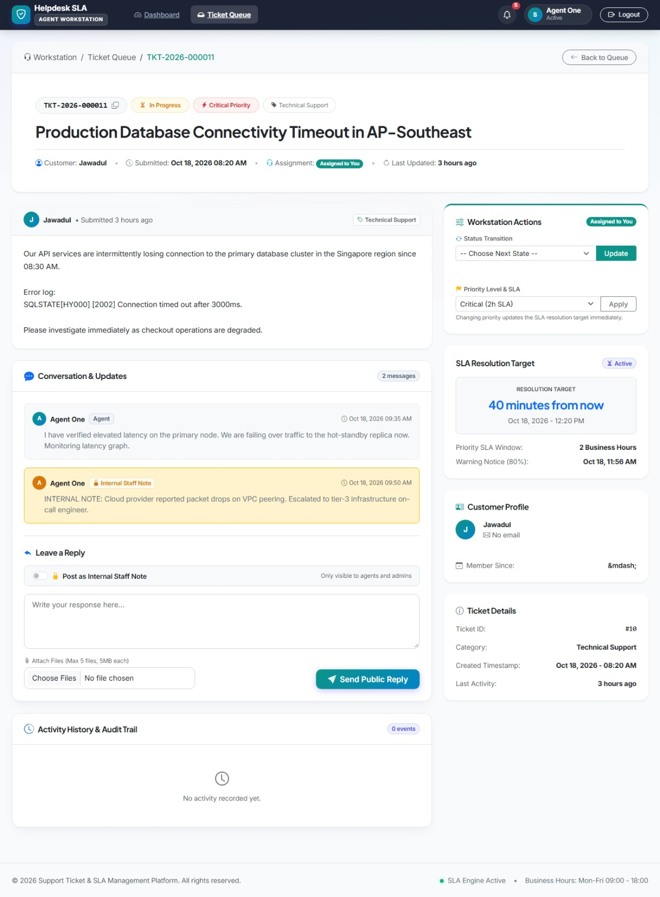
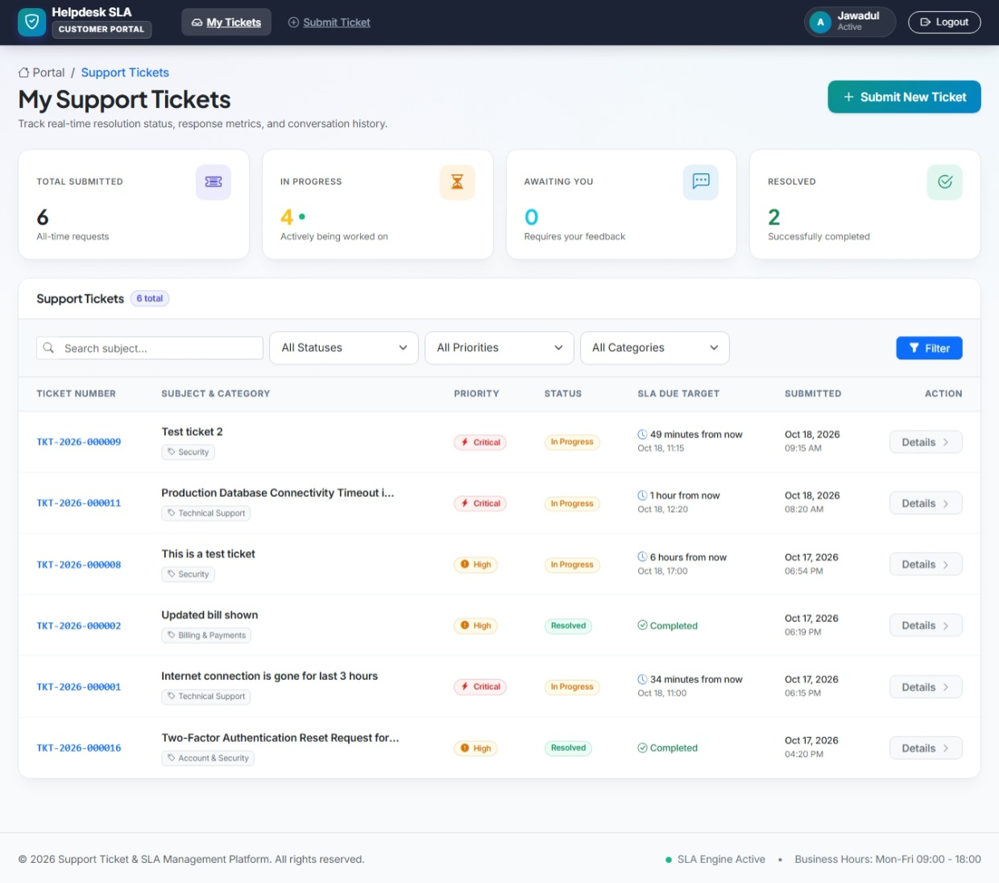

# Support Ticket & SLA Management System

[](https://laravel.com)
[](https://www.php.net)
[](https://www.mysql.com)


An enterprise-grade, high-reliability Support Ticket and Service Level Agreement (SLA) Management System built with **Laravel 13**, featuring multi-guard authentication, precise business-hours SLA deadline calculation, automated agent workload distribution, concurrent sequence numbering, private attachment access control, and memory-flat CSV batch import.

> 🌐 **Live Production Demo**: **[https://techzu-assessment.telerpbd.com](https://techzu-assessment.telerpbd.com)**  
> *(Password for all demo accounts: **`password`**)*
> - 🛡️ **[Super Admin Portal](https://techzu-assessment.telerpbd.com/admin/login)**: `admin@example.com`
> - 🎧 **[Support Agent Portal](https://techzu-assessment.telerpbd.com/agent/login)**: `agent1@example.com`
> - 👤 **[Customer Support Portal](https://techzu-assessment.telerpbd.com/customer/login)**: `customer1@example.com`

---

## Table of Contents

1. [System Overview](#system-overview)
2. [Visual Tour & Application Portals](#visual-tour--application-portals)
3. [Features Checklist](#features-checklist)
4. [Technology Stack](#technology-stack)
5. [System Requirements](#system-requirements)
6. [Installation & Setup](#installation--setup)
7. [Running the Application](#running-the-application)
8. [Demo Accounts](#demo-accounts)
9. [Automated Test Suite](#automated-test-suite)
10. [Architecture Summary](#architecture-summary)
11. [SLA & Business-Hours Engine](#sla--business-hours-engine)
12. [Assignment Strategy](#assignment-strategy)
13. [Concurrency & Sequence Control](#concurrency--sequence-control)
14. [Architecture Assumptions](#architecture-assumptions)
15. [Known Limitations & Roadmap](#known-limitations--roadmap)
16. [Author & Assessment Information](#author--assessment-information)

---

## System Overview

This application manages the end-to-end support ticket lifecycle while strictly enforcing contractual Service Level Agreements (SLAs). Unlike basic ticketing systems that rely on naive wall-clock timers, this system calculates SLA resolution deadlines and breach warnings exclusively within configurable **business operating hours** and workdays, excluding nights, weekends, and holidays.

### Key Architectural Pillars
- **Three Distinct User Roles & Guards**: Complete separation of concerns between `Customer`, `Agent`, and `Admin` using separate database tables, auth guards, policies, and dedicated route namespaces (`routes/customer.php`, `routes/agent.php`, `routes/admin.php`, and `routes/common.php`) for scalability and security as system grows.
- **Strict Data Isolation**: Customers can only view and interact with their own tickets. Support agents work from assigned and unassigned queues. Administrators have complete supervisory oversight.
- **Private File Protection**: Attachments are stored on private non-public storage. Downloads are streamed through a policy-guarded controller that verifies ticket ownership and blocks customer access to internal note attachments.
- **Zero-Gap Atomic Ticket IDs**: Human-readable sequential numbering (`TKT-YYYY-NNNNNN`) protected by pessimistic row-level database locks.
- **Dedicated Common Service Layer**: Cross-portal endpoints (such as streaming private attachments and the In-App Notification Center) reside in a dedicated `routes/common.php` guarded by multi-guard authentication (`auth:customer,agent,admin`).

---

## Visual Tour & Application Portals

### 1. System Command Center (Admin Console)
Centralized supervisory dashboard tracking active ticket queues, unassigned triage pools, SLA breach status, active support agents, and system health in real-time.



---

### 2. Support Agent Workstation & Queue
Specialized workspace displaying assigned workload, unassigned ticket pool ready for claiming, live resolution targets, and quick navigation.



---

### 3. Ticket Resolution, SLA Countdown & Internal Staff Notes
Comprehensive ticket interaction interface showing precision business-hours SLA countdown timer, active lifecycle transition state-machine, and confidential staff-only **Internal Notes** (highlighted in yellow with lock indicator) strictly isolated from customers.



---

### 4. Customer Self-Service Portal
Clean and intuitive customer dashboard showing complete ticket history, status progress badges, and real-time SLA due targets with strict customer data isolation.



---

## Features Checklist

- [x] **Multi-Guard Authentication**: Independent auth guards (`customer`, `agent`, `admin`) with distinct login screens and session management.
- [x] **Atomic Sequential Ticket Numbering**: `TKT-YYYY-NNNNNN` formatted identifiers generated atomically via `ticket_sequences` with row locks.
- [x] **Business-Hours SLA Engine**: Precision deadline computation adhering to working hours (default Sunday–Thursday 09:00–18:00 `Asia/Dhaka`), skipping non-working hours and designated holidays.
- [x] **Proactive SLA Warning & Escalation**: Automatic warning trigger at 80% elapsed time and breach notification via background jobs and console scheduler.
- [x] **Automated Agent Workload Assignment**: Newly created tickets automatically assigned to the available agent with the fewest active tickets; unassigned pool for manual claiming.
- [x] **Ticket Conversations & Internal Notes**: Public customer-facing replies alongside confidential staff-only internal notes.
- [x] **Strict Ticket Lifecycle State Machine**: Enforces valid status transitions (`open` $\rightarrow$ `in_progress` $\rightarrow$ `waiting_for_customer` $\rightarrow$ `resolved` $\rightarrow$ `closed`).
- [x] **Multi-Criteria Search & Filtering**: Paginated filtering across keyword, ticket number prefix, status, priority, category, assigned agent, customer, and date ranges.
- [x] **Optimized Management Dashboards**: Single-query conditional aggregation returning all primary KPI metrics in $\le 3$ database queries.
- [x] **Secure Private Attachments**: Authenticated file streaming with strict policy checks (customer cannot access internal notes' attachments; max 5MB; MIME whitelisting).
- [x] **Streaming CSV Batch Import**: Memory-flat ($O(1)$) streaming ingestion via `fopen`/`fgetcsv`, duplicate skipping by `external_id`, row validation, and downloadable error reports.
- [x] **In-App Notification Center & Live Screen Alerts**: Interactive notification bell in the top navbar with unread counters, mark-as-read controls, dropdown history, and floating toast pop-up alerts appearing in real-time when new replies or SLA escalations arrive for active users.
- [x] **Audit Trail & Activity Logging**: Immutable activity log entries tracking status changes, priority recalculations, assignments, and conversation events.

---

## Technology Stack

- **Backend Framework**: Laravel 13 (PHP 8.3)
- **Database**: MySQL 8.0+
- **Frontend / UI**: Laravel Blade Templates, Bootstrap 5.3 (via CDN), Bootstrap Icons
- **Job Queues**: Laravel Database Queue Worker (`queue:work`)
- **Task Scheduler**: Laravel Console Scheduler (`schedule:work`)
- **Testing**: PHPUnit with in-memory SQLite and mock storage

---

## System Requirements

- **PHP**: `>= 8.3`
  - Required Extensions: `pdo_sqlite` (or `pdo_mysql`), `mbstring`, `openssl`, `tokenizer`, `xml`, `ctype`, `intl`, `bcmath`
- **Composer**: `2.x`
- **Web Server**: Apache / Nginx / Laravel built-in development server

---

## Installation & Setup

Follow these steps to set up the application on your local machine:

### 1. Clone the Repository
```bash
git clone https://github.com/mazharul-webbuilder/Techzu-assessment.git support-ticket-sla-system
cd support-ticket-sla-system
```

### 2. Install Dependencies
```bash
composer install
```

### 3. Configure Environment
Copy the example environment file and generate a unique application key:
```bash
cp .env.example .env
php artisan key:generate
```

Configure your MySQL database connection in `.env`:
```ini
DB_CONNECTION=mysql
DB_HOST=127.0.0.1
DB_PORT=3306
DB_DATABASE=support_ticket_sla
DB_USERNAME=root
DB_PASSWORD=

QUEUE_CONNECTION=database
MAIL_MAILER=log
FILESYSTEM_DISK=local
```

### 4. Create Database & Run Migrations with Seeders
Create a new database in MySQL (matching your `DB_DATABASE` in `.env`) using your preferred client (Laragon, phpMyAdmin, HeidiSQL, MySQL Workbench) or terminal:

```bash
# Via MySQL CLI:
mysql -u root -p -e "CREATE DATABASE IF NOT EXISTS support_ticket_sla CHARACTER SET utf8mb4 COLLATE utf8mb4_unicode_ci;"
```

Then run all migrations and seed demo records:
```bash
php artisan migrate --seed
```

### 5. Create Storage Symlink
Link the storage directory to ensure any public assets or storage references are accessible:
```bash
php artisan storage:link
```

---

## Running the Application

To experience all features (including background SLA escalation, notifications, and CSV processing), run the following three processes:

### 1. Web Application Server
```bash
php artisan serve
```
The application will be accessible at: `http://127.0.0.1:8000`

### 2. Background Queue Worker
Processes email notifications, auto-assignments, and batch CSV imports:
```bash
php artisan queue:work
```

### 3. Task Scheduler (SLA Escalations)
Scans for approaching warnings and breached tickets every minute:
```bash
php artisan schedule:work
```

> **Note on Email Notifications**: By default, `MAIL_MAILER=log`. All dispatched emails are written to `storage/logs/laravel.log`. To inspect notification payloads, open the log file or configure SMTP credentials in `.env`.

---

## Demo Accounts

The database seeder pre-configures test accounts for all roles. All demo accounts use the password: **`password`**

* **Live Base URL**: [https://techzu-assessment.telerpbd.com](https://techzu-assessment.telerpbd.com)

| Portal | Local URL | Live Production URL | Email Address | Password | Role Description |
| :--- | :--- | :--- | :--- | :--- | :--- |
| **System Admin** | `/admin/login` | [`/admin/login`](https://techzu-assessment.telerpbd.com/admin/login) | `admin@example.com` | `password` | Superuser: System dashboard, global assignment, CSV import |
| **Support Agent** | `/agent/login` | [`/agent/login`](https://techzu-assessment.telerpbd.com/agent/login) | `agent1@example.com` | `password` | Agent queue, ticket claiming, resolution, internal notes |
| **Support Agent** | `/agent/login` | [`/agent/login`](https://techzu-assessment.telerpbd.com/agent/login) | `agent2@example.com` | `password` | Secondary support agent for workload balancing |
| **Customer** | `/customer/login` | [`/customer/login`](https://techzu-assessment.telerpbd.com/customer/login) | `customer1@example.com` | `password` | Submits tickets, tracks personal issues, replies |
| **Customer** | `/customer/login` | [`/customer/login`](https://techzu-assessment.telerpbd.com/customer/login) | `customer2@example.com` | `password` | Secondary customer for access boundary testing |

---

## Automated Test Suite

The test suite contains **90 automated tests with 418 assertions**, covering unit logic, feature workflows, concurrency safety, and security policies.

### Run All Tests
```bash
php artisan test
```

### Test Suite Structure
| Test Class | Focus Area |
| :--- | :--- |
| `SlaServiceTest` | Business hours calculator, weekend/holiday skipping, warning threshold |
| `SlaEscalationTest` | Scheduled command, warning notifications, manager escalation flag |
| `TicketNumberGeneratorTest` | Atomic sequence numbering and database row lock protection |
| `TicketAssignmentTest` | Least-loaded auto-assignment, manual claiming, admin reassignment |
| `TicketConversationTest` | Public customer replies, staff internal notes, status transitions |
| `TicketAuthorizationTest` | Multi-guard access barriers and cross-customer isolation |
| `AttachmentTest` | Private disk storage, size/MIME validation, internal note protection |
| `TicketFilterTest` | Multi-criteria filtering, keyword searches, pagination preservation |
| `DashboardTest` | Single conditional aggregation KPIs, query bounds ($\le 3$), workload stats |
| `TicketImportTest` | Memory-flat CSV streaming, duplicate skipping, error report CSV |
| `TicketNotificationTest` | Asynchronous email dispatch for ticket creation, replies, and status |

---

## Architecture Summary

```
                           +------------------------------------+
                           |        Global Router & Auth        |
                           +------------------------------------+
                                 |            |            |
                 +---------------+            |            +---------------+
                 |                            |                            |
       [Guard: customer]              [Guard: agent]               [Guard: admin]
      Customer Portal (/customer)    Agent Queue (/agent)       Admin Console (/admin)
                 |                            |                            |
                 +--------------------+-------+----------------------------+
                                      |
                      +-------------------------------+
                      |      Core Domain Services     |
                      | - TicketService               |
                      | - SlaService                  |
                      | - BusinessHoursCalculator     |
                      | - TicketNumberGenerator       |
                      | - ActivityLogger              |
                      +-------------------------------+
                                      |
                      +-------------------------------+
                      |   Database & Sequence Lock    |
                      | - tickets (indexed)           |
                      | - ticket_sequences (FOR UPDATE|
                      | - ticket_activities (audit)   |
                      +-------------------------------+
```

---

## SLA & Business-Hours Engine

The SLA subsystem ([SlaService.php](app/Services/Common/SlaService.php) & [BusinessHoursCalculator.php](app/Services/Common/BusinessHoursCalculator.php)) calculates resolution deadlines exclusively within operating working hours:

- **Timezone**: Evaluated in `Asia/Dhaka` (UTC+6) while database timestamps remain normalized in UTC.
- **Working Schedule**: Sunday through Thursday, 09:00 to 18:00 (9 working hours per day).
- **Holidays**: Configurable array of excluded calendar dates.
- **Priority SLA Durations**:
  - `Critical`: **2 business hours** (120 minutes)
  - `High`: **8 business hours** (480 minutes)
  - `Medium`: **24 business hours** (1,440 minutes / ~2.6 working days)
  - `Low`: **48 business hours** (2,880 minutes / ~5.3 working days)
- **Early Warning Threshold**: Triggered at **80%** of elapsed SLA time.
- **Priority Changes**: Recalculates both warning and due deadlines from the ticket's original `created_at` timestamp.

---

## Assignment Strategy

Ticket assignment is handled via [TicketAssignmentService.php](app/Services/Common/TicketAssignmentService.php):

1. **Auto-Assignment on Creation**:
   - Queries available agents (`is_available = true`).
   - Counts active tickets per agent (`open`, `in_progress`, `waiting_for_customer`).
   - Assigns the new ticket to the agent with the **lowest active workload**.
   - If no agents are available or all have equal load, tie-breaking selects the agent who least recently received a ticket.
2. **Claim Pool**:
   - If auto-assignment is disabled or no agents are available, tickets remain in the unassigned pool.
   - Any active support agent can claim an unassigned ticket.
3. **Administrative Override**:
   - System administrators can manually assign or reassign any ticket to any agent at any point in the lifecycle.

---

## Concurrency & Sequence Control

To prevent duplicate ticket numbers or gaps under concurrent traffic, ticket number generation is decoupled from primary keys:

- Format: `TKT-YYYY-NNNNNN` (e.g., `TKT-2026-000001`).
- Implemented in [TicketNumberGenerator.php](app/Services/Common/TicketNumberGenerator.php) using a dedicated table: `ticket_sequences`.
- Uses a pessimistic row-level lock:
  ```sql
  SELECT current_value FROM ticket_sequences WHERE year = :year FOR UPDATE;
  ```
- Increments and commits atomically inside the ticket creation database transaction.

---

## Architecture Assumptions

The following assumptions govern the system design:

1. **Three user tables, three guards, three login portals**: Customers, agents, and administrators have completely separate database tables and authentication sessions.
2. **Normalized UTC Timestamps**: All database timestamps are stored in UTC; business hours are projected in `Asia/Dhaka`.
3. **SLA Clock Continuity**: The SLA timer continues running during `waiting_for_customer`, stops upon transitioning to `resolved`, and is not extended if a ticket is reopened.
4. **Retroactive Priority SLA**: Changing a ticket's priority recalculates deadlines relative to its original creation time.
5. **Least-Loaded Workload Model**: Automatic assignment routes to available agents with the fewest active tickets; unassigned tickets remain in the claim pool.
6. **Actor Boundaries**: Customers cannot create tickets on behalf of other customers; administrators supervise and reassign but do not author initial tickets.
7. **Silent CSV Import**: Bulk imported tickets do not trigger outgoing emails and deduplicate against existing rows using `external_id`.
8. **Asynchronous Defaults**: Emails use the `log` mailer locally; `php artisan queue:work` and `php artisan schedule:work` are required for full automated behavior.

---

## Known Limitations & Roadmap

- **Sequence Lock Throughput**: The `SELECT ... FOR UPDATE` lock on `ticket_sequences` is atomic and robust up to moderate high concurrency. At hyper-scale ($>100,000$ tickets/minute), pre-allocating sequence blocks (e.g., reserving batches of 100 IDs in Redis) is recommended.
- **Full-Text Search Engine**: Keyword searching currently uses optimized SQL `LIKE` queries with compound indexes. For multi-million ticket archives, integrate MySQL `FULLTEXT` or Meilisearch/Elasticsearch.
- **Real-Time Client Updates**: Currently, dashboard and queue statistics refresh on page reload or poll intervals. Future releases can incorporate Laravel Reverb or Pusher WebSockets for instant push events.

---

## Author & Assessment Information

This project is develop by **Mazharul Islam** as my technical assessment submission for **Techzu Ichicode Pte Ltd**.

- **Author**: Mazharul Islam
- **Email**: [mazharulislam1998r@gmail.com](mailto:mazharulislam1998r@gmail.com)
- **Submission For**: Techzu Ichicode Pte Ltd (Technical Assessment)
